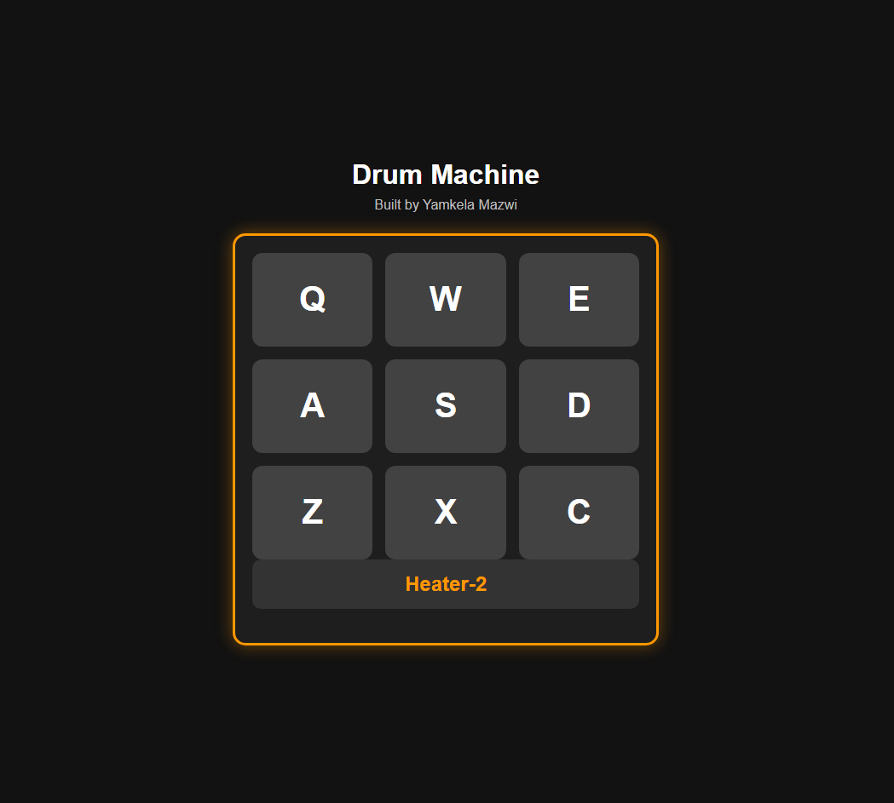

# 🥁 Drum Machine

[](https://developer.mozilla.org/en-US/docs/Web/HTML)
[](https://developer.mozilla.org/en-US/docs/Web/CSS)
[](https://developer.mozilla.org/en-US/docs/Web/JavaScript)
[](https://www.freecodecamp.org/)
[](https://yamkelamazwi.github.io/Drum-Machine/)

A responsive drum machine built as part of the FreeCodeCamp Front End Development Libraries certification. Users can trigger audio samples using either mouse clicks or keyboard controls while viewing the active sound name on the display panel.

## 🔗 Live Demo

👉 https://yamkelamazwi.github.io/Drum-Machine/

## 📂 Repository

👉 https://github.com/yamkelamazwi/Drum-Machine

## 📸 Screenshot



## ✨ Features

- Nine interactive drum pads
- Keyboard support (Q, W, E, A, S, D, Z, X, C)
- Mouse click support
- Real-time display updates
- Responsive mobile-first layout
- Audio replay support using `currentTime = 0`
- FCC Drum Machine project requirements satisfied

## 🛠️ Technologies Used

- HTML5
- CSS3
- JavaScript (ES6)

## 🎮 Controls

| Key | Sound |
|------|--------|
| Q | Heater 1 |
| W | Heater 2 |
| E | Heater 3 |
| A | Heater 4 |
| S | Clap |
| D | Open HH |
| Z | Kick n Hat |
| X | Kick |
| C | Closed HH |

## 🚧 Challenges & Pain Points

### Audio Trigger Mapping

One challenge was connecting keyboard events to the correct audio element. This required understanding how the browser's `KeyboardEvent` object exposes the pressed key through `event.key`.

### Dynamic Display Updates

Updating the display for both click events and keyboard events required ensuring a single source of truth for the active drum pad.

### Audio Replay Handling

Without resetting the audio playback position using:

```javascript
audio.currentTime = 0;
```

rapid consecutive key presses would not replay the drum sample correctly.

### FCC Test Compliance

A significant challenge was ensuring the application met FreeCodeCamp's strict user stories, including:

- Exact drum pad ordering
- Matching keyboard ids
- Unique audio identifiers
- Correct display updates
- Keyboard and click interaction support

## 🔍 Edge Cases Considered

- Users repeatedly pressing the same key
- Lowercase and uppercase keyboard inputs
- Triggering pads using mouse clicks instead of keyboard input
- Fast consecutive audio playback
- Mobile screen responsiveness

## 🚀 Future Improvements

- Volume controls
- Sound bank switching
- Dark/Light themes
- Visual animation when pads are triggered
- Recording and playback functionality

## 👨‍💻 Author

**Yamkela Mazwi**

Built as part of the FreeCodeCamp curriculum and customized with responsive styling and keyboard interactions.
